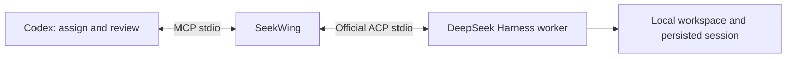

# SeekWing


**DeepSeek subagents for Codex.** Delegate with MCP. Execute with official ACP. Review with Codex.

[简体中文](README.zh-CN.md) · [MIT](LICENSE)

SeekWing lets Codex assign scoped work to DeepSeek Harness, wait for results, continue the same session with corrections, and independently check files and tests. **Seek** comes from DeepSeek; **Wing** is your coding wingman.

**v0.1.2 fixes native read-only preset activation and surfaces startup warnings in `doctor`.** Real generation, persistent session resume, code edits and native read-only write denial have been tested on macOS with Harness Desktop **0.2.1-rc.2**, Node **24.12.0** and `deepseek-official/deepseek-flash`. The protocol fixture also runs in Linux CI. Windows and other Harness versions have not been tested.



The plugin packages an MCP server and a review skill. The terminal command launches the server or diagnoses setup. Each turn uses an independent Harness process; follow-ups resume the same durable session. It does not control an already running Desktop process or automatically target another computer.

## Install in Codex

Requirements: Node.js **22+**, a current Codex build with plugin support, the [official DeepSeek Harness CLI](https://github.com/deepseek-ai/deepseek-harness), and credentials for your chosen Harness provider.

```sh
codex plugin marketplace add heyzeyu/seekwing
codex plugin add seekwing@seekwing-marketplace
```

The prebuilt server and dependency licenses are committed. Plugin installation needs no npm release, `npm install` or build step. Open a fresh local Codex chat if tools are not yet available.

For local development, clone this repo, enter its directory, then use:

```sh
codex plugin marketplace add "$PWD"
codex plugin add seekwing@seekwing-marketplace
node ./dist/seekwing.mjs doctor
```

Configure `DEEPSEEK_API_KEY` in the environment of the process that launches Codex for the default official API route. The Codex compatibility overlay forwards it and the documented SeekWing/proxy variables to this MCP server. An already running GUI app may not inherit variables exported in a new terminal. Do not commit credentials or send them in prompts.

On macOS, SeekWing prefers the real Desktop CLI:

```text
/Applications/DeepSeek Harness.app/Contents/Resources/runtime/cli/bin/dsh
```

Otherwise it finds `dsh` on `PATH`. Set `SEEKWING_DSH_COMMAND` to an absolute executable path for another installation. The executable must identify itself as the official Harness ACP agent. SeekWing never downloads or executes a package through `npx` automatically.

`doctor` verifies the ACP handshake, without calling a model. It does not validate credentials or prove generation works. For an end-to-end check, delegate a small read-only task and wait for its result.

## Use it

Give Codex an assignment such as:

> Use SeekWing to have DeepSeek investigate the failing test in this workspace, read-only. Verify its diagnosis against the source yourself.

> Have DeepSeek fix this bug. It may edit the files needed in this workspace. Review the diff and independently rerun relevant tests before accepting it.

> Send these review findings back to the same DeepSeek session and check the corrected result.

The skill makes scope and acceptance criteria explicit. Default tasks are read-only; authorized edits use `workspace-write`. It preserves an explicitly selected model using the exact ACP-advertised choice.

## MCP tools

| Tool | Purpose |
| --- | --- |
| `doctor` | Check the official CLI and ACP handshake without calling a model. |
| `inspect_models` | Read model/reasoning options; creates and closes an empty session. |
| `start_task` | Start a task and return its run ID; defaults to read-only and a 600-second deadline. |
| `get_task` | Read paginated output, progress, permissions and recent tool evidence. |
| `wait_task` | Wait up to 30 seconds for completion or attention; timeout leaves the task running. |
| `reply_task` | Resume a finished run's session, preserving workspace and permission mode. |
| `cancel_task` | Cancel and wait for the owned worker to stop; does not undo edits. |
| `respond_to_permission` | Select an advertised one-time permission decision. Never automatically approved. |
| `list_tasks` | Read durable runs, including interrupted runs after a restart. |

Example `start_task` arguments:

```json
{
  "workspace": "/absolute/path/to/project",
  "instruction": "Fix the addition bug in sum.mjs. Change only that file.",
  "acceptance": "The existing node --test sum.test.mjs passes; tests remain unchanged.",
  "permissionMode": "workspace-write",
  "timeoutSeconds": 600,
  "idempotencyKey": "sum-fix-1"
}
```

Creation is an acknowledgement, not completion. Reuse an idempotency key only for identical inputs. Records include session and parent-run IDs, selected ACP `modelValue`, output, tool statuses, timestamps, stop reason and cleanup errors. `configuredDefaultRoute` is the process fallback; the actual selection is in `modelValue` and `configOptions`.

`completed` means ACP returned `end_turn` and the worker stopped. **Codex still checks the acceptance criteria.** Token-limit stops are `incomplete`; model/transport errors are `failed`. Failed tool calls remain visible even in a completed turn. An interrupted task is never automatically replayed: inspect its workspace before resuming.

## Permissions and data

SeekWing sets both `DSH_PERMISSION_MODE` and a final native Harness configuration overlay. `read-only` and `workspace-write` are actual native sandbox modes, not just prompt instructions. It does not expose `danger-full-access`. Read-only tasks cannot be escalated through SeekWing. Workspace-write permission requests are forwarded; `allow_once` requires human authorization for that specific escalation. Normal permission to edit a project does not grant access outside its sandbox.

Instructions are not a per-file enforcement mechanism. Use a separate checkout/worktree when isolation is needed. `SEEKWING_ALLOWED_ROOTS` checks the selected workspace, including its real path; it is not an additional read-access sandbox. Trust the configured Harness executable, home and plugins.

Default private state locations:

| Platform | Directory |
| --- | --- |
| macOS | `~/Library/Application Support/SeekWing` |
| Linux | `$XDG_STATE_HOME/seekwing` or `~/.local/state/seekwing` |
| Windows, untested | `%LOCALAPPDATA%/SeekWing` |

The default Harness home is `<state>/harness`, separate from Desktop. Bridge records are atomically written with private file permissions and contain task instructions and evidence. Known credential environment values and common bearer/key patterns are redacted, but arbitrary secrets in source files are not guaranteed to be recognized. Avoid unnecessarily delegating sensitive data. The bridge does not retain thought chunks; Harness retains its normal session history.

Task deadlines range from 10 to 3600 seconds. Cancellation uses ACP first, then terminates the owned process group if needed. Terminal status follows cleanup. Concurrency is limited per MCP server; session locks are shared by servers using the same state directory. History has no automatic expiry; stop related tasks before removing state.

## Configuration

| Variable | Default / purpose |
| --- | --- |
| `SEEKWING_DSH_COMMAND` | Absolute official CLI; macOS Desktop first, then `PATH`. |
| `SEEKWING_DSH_ARGS` | JSON array of trusted launcher prefix arguments, default `[]`. Task text goes over ACP, never through shell interpolation. |
| `SEEKWING_STATE_DIR` | Platform state directory above. |
| `SEEKWING_DSH_HOME` | `<state>/harness`; explicitly choose an existing trusted home to reuse it. |
| `SEEKWING_PROVIDER` | `deepseek-official`. |
| `SEEKWING_MODEL` | `deepseek-flash`; must exist in the installed Harness/provider. |
| `SEEKWING_ALLOWED_ROOTS` | Optional absolute roots separated by the platform path delimiter. |
| `SEEKWING_MAX_CONCURRENT` | `2`, configurable from `1` to `8` per server. |
| `DEEPSEEK_API_KEY` | Credential for the default official API provider. |

Reusing a Desktop login requires explicitly choosing its trusted Harness home and matching provider, such as `deepseek-account`. This login route has not been end-to-end tested in this release. Sharing a home does not deliver realtime events to Desktop: an already-open window may need its session list refreshed and the correct workspace selected. No P330/SSH transport is included.

For another MCP client, launch `node /absolute/path/to/seekwing/dist/seekwing.mjs mcp` and configure its environment forwarding. Stdout is MCP-only. Portable manifests are accompanied by a Codex compatibility overlay for environment forwarding.

## Development and tests

```sh
npm ci --ignore-scripts
npm run check
npm run build
npm test
npm pack --dry-run
```

Deterministic tests use an independent ACP wire fixture. They cover completion, durable follow-up, idempotency, permission forwarding, session locks, cross-process cancellation, deadlines, output caps, redaction, workspace-root validation and crash recovery. No provider credentials are needed.

The opt-in smoke test **calls DeepSeek and consumes normal provider usage**. It edits only its generated scratch workspace and independently reruns the example test:

```sh
SEEKWING_NATIVE_TEST_ROOT=/absolute/path/to/scratch node test/native-smoke.mjs
```

The committed `dist/seekwing.mjs` and `dist/THIRD_PARTY_NOTICES.txt` make clean plugin installs runnable. CI rebuilds and checks for differences. Dependencies are locked; ACP SDK **1.4.0** matches the tested Harness.

## References and license

- [Official Harness ACP](https://github.com/deepseek-ai/deepseek-harness/tree/master/packages/acp/acp)
- [Agent Client Protocol](https://agentclientprotocol.com/)
- [OpenAI plugin packaging](https://developers.openai.com/plugins/build/plugins)

Independent project, not affiliated with DeepSeek AI or OpenAI. Source: [MIT](LICENSE). Bundled dependencies: [third-party notices](dist/THIRD_PARTY_NOTICES.txt).
