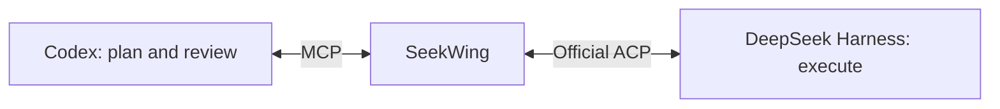

# SeekWing

**DeepSeek subagents for Codex.**

[简体中文](README.zh-CN.md) · [MIT License](LICENSE)

SeekWing is an early-stage open-source project for delegating work from Codex to DeepSeek Harness. The planned Codex plugin combines an MCP service with a review workflow: Codex defines the task, DeepSeek executes it, and Codex checks the changes and verifies the result.

**Status: design stage. There is no installable plugin or ACP bridge yet.**

## The name

**Seek** comes from DeepSeek. **Wing** evokes a wingman: a capable partner that takes on delegated work while Codex coordinates and reviews.

## Planned architecture

- A **Codex plugin** packages the integration and its workflow skill.
- An **MCP service** exposes task creation, progress, results, follow-ups, and cancellation.
- The **official Harness ACP** manages the worker runtime and persistent sessions.
- A **review skill** guides Codex to inspect artifacts and run independent checks before accepting a result.

The ACP worker runs in a separate Harness process. Controlling an already running Desktop session is outside the initial scope.

## Initial roadmap

- [ ] Implement the ACP bridge and session lifecycle.
- [ ] Expose `start_task`, `get_task`, `wait_task`, `reply_task`, and `cancel_task` through MCP.
- [ ] Persist task state, results, and execution evidence.
- [ ] Add the delegation and review skill.
- [ ] Verify a complete task, review, correction, and acceptance cycle.
- [ ] Package the first local Codex plugin release.

## References

- [DeepSeek Harness](https://github.com/deepseek-ai/deepseek-harness)
- [Official Harness ACP](https://github.com/deepseek-ai/deepseek-harness/tree/master/packages/acp/acp)
- [OpenAI plugin documentation](https://developers.openai.com/plugins)

SeekWing is an independent project, not affiliated with DeepSeek AI or OpenAI.

## License

[MIT](LICENSE).
