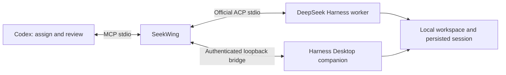

# SeekWing


**DeepSeek subagents for Codex.** Delegate with MCP. Execute through ACP or visible Desktop sessions. Review with Codex.

[简体中文](README.zh-CN.md) · [MIT](LICENSE)

SeekWing lets Codex assign scoped work to DeepSeek Harness, wait for results, continue the same session with corrections, and independently check files and tests. **Seek** comes from DeepSeek; **Wing** is your coding wingman.

**v0.2.3 adds another review pass:** atomic cross-process controls, accurate concurrent idempotency records, escaped-credential redaction and bounded history reads. [Review record](docs/review-v023.zh-CN.md) · [Previous overall review](docs/final-review.zh-CN.md) · [Source comparison](docs/reference-review.zh-CN.md).

Visible Desktop sessions were introduced in v0.2.0 alongside background ACP. Real generation, same-session follow-up and file edits have been verified on macOS with Harness Desktop **0.2.1-rc.2**, Node **24.12.0** and DeepSeek Flash / High. Windows and other Harness versions remain untested.



The plugin packages an MCP server and a review skill. Background turns use an isolated official ACP process; Desktop turns run inside the current Harness Host. Both support persistent follow-up. Execution is local; P330/SSH routing is not included.

## Install in Codex

Requirements: Node.js **22+**, a current Codex build with plugin support, the [official DeepSeek Harness CLI](https://github.com/deepseek-ai/deepseek-harness), and credentials for your chosen Harness provider.

```sh
codex plugin marketplace add heyzeyu/seekwing
codex plugin add seekwing@seekwing-marketplace
```

The prebuilt server and dependency licenses are committed. Plugin installation needs no npm release, `npm install` or build step. Open a fresh local Codex chat if tools are not yet available.

For local development, clone this repo, enter its directory, then use:

```sh
codex plugin marketplace add "$PWD"
codex plugin add seekwing@seekwing-marketplace
node ./dist/seekwing.mjs doctor
```

Configure `DEEPSEEK_API_KEY` in the environment of the process that launches Codex for the default official API route. The Codex compatibility overlay forwards it and the documented SeekWing/proxy variables to this MCP server. An already running GUI app may not inherit variables exported in a new terminal. Do not commit credentials or send them in prompts.

On macOS, SeekWing prefers the real Desktop CLI:

```text
/Applications/DeepSeek Harness.app/Contents/Resources/runtime/cli/bin/dsh
```

Otherwise it finds `dsh` on `PATH`. Set `SEEKWING_DSH_COMMAND` to an absolute executable path for another installation. The executable must identify itself as the official Harness ACP agent. SeekWing never downloads or executes a package through `npx` automatically.

`doctor` verifies the configured mode's handshake without calling a model. It does not validate credentials or prove generation works. For an end-to-end check, delegate a small read-only task and wait for its result. Desktop diagnostics report the MCP `version` and running `companionVersion` separately, with an upgrade/restart warning when they differ.

## Enable Desktop mode

From this repository or the installed SeekWing plugin directory:

```sh
node ./dist/seekwing.mjs desktop-install
node ./dist/seekwing.mjs desktop-doctor
```

The installer copies the companion to a stable SeekWing state directory and registers it with official `dsh plugin --profile desktop add`, preserving existing profile configuration. First installation may hot-load. **Restart DeepSeek Harness after companion updates**, then run `desktop-doctor`. Open a fresh local Codex chat after upgrading the Codex plugin to load its new tool schemas.

| Mode | Runtime | Desktop visibility | Credentials and approvals |
| --- | --- | --- | --- |
| `background` (default) | Isolated official ACP worker | Separate history | SeekWing Home; permission requests reach Codex |
| `desktop` | Companion inside the current Harness Host | Native workspace and conversation list | Existing Desktop login/models; approvals and questions stay in Harness |

Pass `"sessionMode": "desktop"` to `start_task`, `doctor` or `inspect_models`. Or ask Codex to use Desktop mode so the conversation is visible in Harness. Expand the workspace to find `SeekWing · <directory>`. `reply_task` preserves the original mode, workspace and permission policy. Set `SEEKWING_SESSION_MODE=desktop` to change the new-task default.

The companion binds only a random loopback port, uses a fresh Host token and private endpoint descriptor, and rejects browser Origins, incorrect Hosts and stale instances. **Treat the descriptor as a credential.** Connection errors fail explicitly rather than falling back to another model/runtime. Existing background sessions are not migrated automatically.

An unchanged selection does not rewrite defaults. Explicit Desktop model selection uses the official API, which also changes the Harness model default, matching its native UI behavior. A busy session is rejected. Do not send another manual prompt into a delegated turn; foreign prompts make result ownership uncertain. Cancellation stops only the owned turn and preserves the conversation and Desktop app. Host restart/disconnection never automatically replays instructions. Model controls, prompt admission, cancellation and cleanup are serialized per turn; a cancelled turn cannot be submitted later. Cleanup preserves a later manual conversation turn.

To remove the companion, use Desktop's bundled `dsh plugin --profile desktop remove seekwing-desktop`, then restart Harness. Background mode remains available.

## Use it

Give Codex an assignment such as:

> Use SeekWing to have DeepSeek investigate the failing test in this workspace, read-only. Verify its diagnosis against the source yourself.

> Have DeepSeek fix this bug. It may edit the files needed in this workspace. Review the diff and independently rerun relevant tests before accepting it.

> Send these review findings back to the same DeepSeek session and check the corrected result.

The skill makes scope and acceptance criteria explicit. Default tasks are read-only; authorized edits use `workspace-write`. It preserves an explicitly selected model using the exact choice returned by `inspect_models` for that runtime.

## MCP tools

| Tool | Purpose |
| --- | --- |
| `doctor` | Check the selected background ACP or Desktop companion handshake without generation. |
| `inspect_models` | Read runtime-specific model/reasoning options; Desktop creates no empty session. |
| `start_task` | Start a task and return its run ID; defaults to read-only and a 600-second deadline. |
| `get_task` | Read paginated output, progress, permissions and recent tool evidence. |
| `wait_task` | Wait up to 30 seconds for completion or attention; timeout leaves the task running. |
| `reply_task` | Resume a finished run's session, preserving workspace and permission mode. |
| `cancel_task` | Cancel and wait for the owned worker to stop; does not undo edits. |
| `respond_to_permission` | Select an advertised one-time permission decision. Never automatically approved. |
| `list_tasks` | Read durable runs, including interrupted runs after a restart. |

Example `start_task` arguments:

```json
{
  "workspace": "/absolute/path/to/project",
  "instruction": "Fix the addition bug in sum.mjs. Change only that file.",
  "acceptance": "The existing node --test sum.test.mjs passes; tests remain unchanged.",
  "permissionMode": "workspace-write",
  "sessionMode": "desktop",
  "timeoutSeconds": 600,
  "idempotencyKey": "sum-fix-1"
}
```

Creation is an acknowledgement, not completion. Reuse an idempotency key only for identical inputs. Records include session and parent-run IDs, `sessionMode`, selected `modelValue`, output, tool statuses, timestamps, stop reason and cleanup errors. `configuredDefaultRoute` is the process fallback; the actual selection is in `modelValue` and `configOptions`.

A confirmed `end_turn` response stays `completed` if a user cancel races with completion; the cancellation request is still recorded. Task deadlines still fail expired work.

`completed` means the native turn ended and SeekWing released its worker. Desktop conversations remain open. **Codex still checks the acceptance criteria.** Token-limit stops are `incomplete`; model/transport errors are `failed`. Failed tool calls remain visible even in a completed turn. An interrupted task is never automatically replayed: inspect its workspace before resuming.

## Permissions and data

Background mode sets `DSH_PERMISSION_MODE` and a final native configuration overlay. Desktop mode sets native session-level sandbox and approval events. `read-only` and `workspace-write` are actual native sandbox modes, not just prompt instructions. It does not expose `danger-full-access`. Read-only tasks cannot be escalated through SeekWing. Background workspace-write permission requests are forwarded to Codex; Desktop approvals stay in Harness; `allow_once` requires human authorization for that specific escalation. Normal permission to edit a project does not grant access outside its sandbox.

Instructions are not a per-file enforcement mechanism. Use a separate checkout/worktree when isolation is needed. `SEEKWING_ALLOWED_ROOTS` checks the selected workspace, including its real path; it is not an additional read-access sandbox. Trust the configured Harness executable, home and plugins.

Default private state locations:

| Platform | Directory |
| --- | --- |
| macOS | `~/Library/Application Support/SeekWing` |
| Linux | `$XDG_STATE_HOME/seekwing` or `~/.local/state/seekwing` |
| Windows, untested | `%LOCALAPPDATA%/SeekWing` |

The background Harness home is `<state>/harness`, separate from Desktop. Desktop mode uses the current Host's native storage. Bridge records are atomically written with private file permissions and contain task instructions and evidence. Known credential environment values, their common JSON-escaped forms in records and nested native tool evidence, and common bearer/key patterns are redacted. Arbitrary secrets in source files are not guaranteed to be recognized. Avoid unnecessarily delegating sensitive data. The bridge does not retain thought chunks; Harness retains its normal session history.

Cross-process cancellation and permission controls are published as complete files; owners cannot consume a partially written message. Failed writes deliver no command. Concurrent retries keep the original `idempotencyKey`; losing or uncertain requests create no replacement task record and never automatically replay an instruction.

Desktop HTTP bodies are capped at 512 KiB and decoded after byte assembly, preserving split UTF-8 and supported long prompts. Both backends reject incompatible protocol versions before sending instructions. Upgrade the companion with `desktop-install` and restart Harness for this release.

Task deadlines range from 10 to 3600 seconds. Background cancellation uses ACP and then its owned process group if needed. Desktop uses native session cancellation and never kills the Host; uncertain cleanup is reported. Terminal status follows cleanup. Concurrency is limited per MCP server, with an additional eight-run limit in the Desktop Host; session locks are shared by servers using the same state directory. History has no automatic expiry; stop related tasks before removing state.

Evidence write failures cancel the affected turn and expose `persistenceError`; the task cannot report normal completion. Transient failures recover the write queue and persist the failure. If storage remains unavailable, this MCP retains failed results in memory and refuses new execution. Restore storage and restart that MCP. Unpersisted results cannot survive process exit; older records are treated as interrupted and instructions are never replayed automatically.

Session locks are published atomically and stale-owner reclamation is serialized and revalidated. A crash during reclamation can leave a `.recovery` marker. Recovery then fails closed with its path; confirm the relevant process and native turn have stopped before inspecting and removing that marker. Never clear lock files while tasks are running.

History listing reads at most eight records concurrently and retains only the requested newest records. It still scans history; it does not yet use a paginated index.

## Configuration

| Variable | Default / purpose |
| --- | --- |
| `SEEKWING_DSH_COMMAND` | Absolute official CLI; macOS Desktop first, then `PATH`. |
| `SEEKWING_DSH_ARGS` | JSON array of trusted launcher prefix arguments, default `[]`. Task text goes over ACP, never through shell interpolation. |
| `SEEKWING_STATE_DIR` | Platform state directory above. |
| `SEEKWING_SESSION_MODE` | `background` or `desktop`; per-task overrides are supported. |
| `SEEKWING_DESKTOP_ENDPOINT` | `<state>/desktop/endpoint.json`; custom directories and filenames are supported. Use the same value for installation and the client. |
| `SEEKWING_DESKTOP_HOME` | Installer only: `DSH_HOME` or `~/.dsh`, selecting the Desktop profile. |
| `SEEKWING_DSH_HOME` | `<state>/harness`; explicitly choose an existing trusted home to reuse it. |
| `SEEKWING_PROVIDER` | `deepseek-official`. |
| `SEEKWING_MODEL` | `deepseek-flash`; must exist in the installed Harness/provider. |
| `SEEKWING_ALLOWED_ROOTS` | Optional absolute roots separated by the platform path delimiter. |
| `SEEKWING_MAX_CONCURRENT` | `2`, configurable from `1` to `8` per server. |
| `DEEPSEEK_API_KEY` | Credential for the default official API provider. |

Desktop mode uses the current Harness login and was verified with `deepseek-account/deepseek-flash`, High. Merely sharing `DSH_HOME` with an ACP worker does not register sessions in the running Desktop workspace or deliver live events; use the companion for that behavior.

For another MCP client, launch `node /absolute/path/to/seekwing/dist/seekwing.mjs mcp` and configure its environment forwarding. Stdout is MCP-only. Portable manifests are accompanied by a Codex compatibility overlay for environment forwarding.

## Development and tests

```sh
npm ci --ignore-scripts
npm run check
npm run build
npm test
npm pack --dry-run
```

48 deterministic tests use an independent ACP wire fixture and native Host adapter, covering both modes, loopback authentication, session ownership, cancellation and explicit failure without fallback. They cover completion, durable follow-up, idempotency, permission forwarding, session locks, cross-process cancellation and permission rejection, deadlines, output caps, redaction, workspace-root validation and crash recovery. This release adds partial and failed control writes, idempotency contention, escaped credentials, nested native JSON and bounded history reads. No provider credentials are needed.

The opt-in smoke test **calls DeepSeek and consumes normal provider usage**. It edits only its generated scratch workspace and independently reruns the example test:

```sh
SEEKWING_NATIVE_TEST_ROOT=/absolute/path/to/scratch node test/native-smoke.mjs

# With the companion installed and Harness running:
SEEKWING_SESSION_MODE=desktop SEEKWING_NATIVE_TEST_ROOT=/absolute/path/to/scratch node test/native-smoke.mjs
```

The committed `dist/seekwing.mjs`, `desktop/index.mjs` and `dist/THIRD_PARTY_NOTICES.txt` make clean plugin installs runnable. CI rebuilds and checks for differences. Dependencies are locked; ACP SDK **1.4.0** matches the tested Harness.

## References and license

- [Official Harness ACP](https://github.com/deepseek-ai/deepseek-harness/tree/master/packages/acp/acp)
- [Agent Client Protocol](https://agentclientprotocol.com/)
- [OpenAI plugin packaging](https://developers.openai.com/plugins/build/plugins)

Independent project, not affiliated with DeepSeek AI or OpenAI. Source: [MIT](LICENSE). Bundled dependencies: [third-party notices](dist/THIRD_PARTY_NOTICES.txt).
