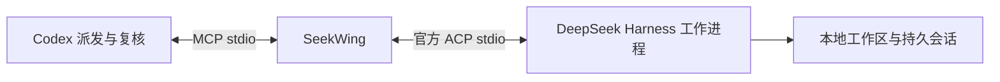

# SeekWing · 寻翼


**让 DeepSeek 成为 Codex 的子代理。Codex 派任务，DeepSeek 执行，Codex 复核。**

[English](README.md) · [MIT](LICENSE)

Seek 来自 DeepSeek，Wing 代表搭档和僚机。插件采用 **MCP 服务 + 委派复核 Skill**，通过官方 ACP 启动 DeepSeek Harness。终端命令用于启动 MCP 和诊断连接。

**v0.1.3 修复升级清理旧目录后 `doctor` 失效的问题；v0.1.2 修复只读权限预设激活，并返回启动警告**：在 macOS、Node 24.12.0、Harness Desktop 0.2.1-rc.2 和 `deepseek-official/deepseek-flash` 上，验证了真实生成、同一会话续聊、修改代码，以及原生只读沙箱拒绝写入。协议模拟测试也在 Linux CI 中运行；Windows 和其他 Harness 版本尚未实测。



每轮使用独立的 Harness 进程，追加指令恢复同一个持久会话。它不直接控制已经打开的 Desktop 进程，也不会自动把任务发到 P330。

## 安装

需要 Node.js **22+**、支持插件的新版 Codex、[官方 Harness CLI](https://github.com/deepseek-ai/deepseek-harness)，以及所选模型供应商的凭据。

```sh
codex plugin marketplace add heyzeyu/seekwing
codex plugin add seekwing@seekwing-marketplace
```

仓库包含构建好的 MCP 服务和依赖许可证。安装不需要执行 `npm install` 或构建，也不依赖尚未发布的 npm 包。安装后，如果当前聊天没有出现工具，打开新的本地 Codex 聊天。

本地开发时，克隆仓库并进入目录，然后执行：

```sh
codex plugin marketplace add "$PWD"
codex plugin add seekwing@seekwing-marketplace
node ./dist/seekwing.mjs doctor
```

默认走官方 API。在**启动 Codex 的进程环境中**设置 `DEEPSEEK_API_KEY`。兼容层会将它和文档列出的 SeekWing、代理环境变量传给这个 MCP。已运行的 GUI 不一定继承后来在终端设置的变量。不要将密钥提交进配置文件或放进任务指令。

macOS 优先使用真正的 Desktop 内置 CLI，避免误用同名的 SSH 脚本：

```text
/Applications/DeepSeek Harness.app/Contents/Resources/runtime/cli/bin/dsh
```

其他安装从 `PATH` 查找 `dsh`，也可用 `SEEKWING_DSH_COMMAND` 指定可执行文件的绝对路径。启动后检查官方 Harness ACP 身份，不会自动通过 `npx` 下载并执行软件。

`doctor` 只验证 ACP 握手，不代表密钥有效或模型生成成功。完整检查需要派发一个小任务并等待真实结果。

## 使用方式

安装启用后，直接对 Codex 说：

> 用 SeekWing 让 DeepSeek 只读分析这个项目为什么测试失败，你核对它的结论。

> 让 DeepSeek 修复这个问题，允许修改当前工作区里相关的文件。你审核 diff，并独立重跑相关测试。

> 把这几条审核意见发回刚才的 DeepSeek 会话，让它修正后你再检查。

Skill 会明确工作区、允许范围和验收标准。分析默认只读；已授权的代码修改使用 `workspace-write`，无需重复确认。指定模型时，使用 ACP 公布的原始选项，不静默切换模型。

## MCP 工具

| 工具 | 作用 |
| --- | --- |
| `doctor` | 检查官方 CLI 和 ACP 握手，不调用模型。 |
| `inspect_models` | 读取模型和推理选项；创建并关闭空会话。 |
| `start_task` | 创建任务并返回 ID；默认只读、600 秒截止时间。 |
| `get_task` | 读取分页输出、进度、权限请求和最近的工具证据。 |
| `wait_task` | 单次最多等 30 秒；等待超时不会取消任务。 |
| `reply_task` | 继续已结束任务的原会话，保留工作区和权限。 |
| `cancel_task` | 取消并等待工作进程停止；不回滚文件。 |
| `respond_to_permission` | 对原生权限请求作一次性选择，不自动批准。 |
| `list_tasks` | 读取持久记录，包括服务重启后的中断任务。 |

派发参数示例：

```json
{
  "workspace": "/absolute/path/to/project",
  "instruction": "修复 sum.mjs 的加法错误，只修改这个文件。",
  "acceptance": "现有 node --test sum.test.mjs 通过，测试文件不变。",
  "permissionMode": "workspace-write",
  "timeoutSeconds": 600,
  "idempotencyKey": "sum-fix-1"
}
```

创建成功只代表收到任务。同一份指令重试时复用 `idempotencyKey`，不要在同一个 key 下更改参数。记录包含会话 ID、前一轮 ID、实际选择的 ACP `modelValue`、输出、工具状态和结束原因。`configuredDefaultRoute` 是默认路由，实际选择以 `modelValue`、`configOptions` 为准。

`completed` 表示 ACP 返回 `end_turn` 且工作进程已停止，**仍需 Codex 核对验收标准**。输出上限停止标为 `incomplete`，模型或连接错误标为 `failed`。已完成的一轮也可能有失败的工具调用，需要复核。服务中断后不会自动重放指令，应先检查是否已经修改了文件。

## 权限与数据

同时设置 `DSH_PERMISSION_MODE` 和最后一层原生 Harness 配置，使用真正的 `read-only` / `workspace-write` 沙箱，不暴露 `danger-full-access`。只读任务不能通过 SeekWing 提权。写入任务的原生权限请求会转交 Codex；只有用户授权了该次越界操作时，才能选择 `allow_once`。普通项目编辑授权不包含沙箱外权限。

任务文本不是逐文件强制白名单。需要隔离其他修改时，使用独立 checkout/worktree。`SEEKWING_ALLOWED_ROOTS` 检查提交时选择的工作区和真实路径，不是额外的读取权限沙箱。配置的 Harness 程序、Home 和插件应当可信。

默认状态目录：

- macOS：`~/Library/Application Support/SeekWing`
- Linux：`$XDG_STATE_HOME/seekwing`，未设置则为 `~/.local/state/seekwing`
- Windows（未实测）：`%LOCALAPPDATA%/SeekWing`

默认 Harness Home 是状态目录中的 `harness/`，与 Desktop 分开。记录包含任务指令和执行证据，使用原子写入和私有文件权限。桥接层过滤已知凭据环境变量的值和常见 token 格式，但不能保证识别源码中的所有秘密，不应派发不必要的敏感内容。桥接层不保存思考片段；Harness 自身保留原生会话历史。

截止时间可设为 10–3600 秒。取消先走 ACP，不响应时终止所拥有的进程组，清理结束后才标记终态。并发上限按 MCP 进程计算；使用同一状态目录的服务共享会话锁。历史没有自动过期，删除前应确认相关任务已停止。

## 配置

| 环境变量 | 默认值 / 含义 |
| --- | --- |
| `SEEKWING_DSH_COMMAND` | 官方 CLI 绝对路径；macOS 优先内置 CLI，再查 `PATH`。 |
| `SEEKWING_DSH_ARGS` | 可信启动参数前缀的 JSON 数组，默认 `[]`；任务通过 ACP 传输，不拼接 shell 命令。 |
| `SEEKWING_STATE_DIR` | 上述平台状态目录。 |
| `SEEKWING_DSH_HOME` | `<状态目录>/harness`；可显式指定已有可信 Home。 |
| `SEEKWING_PROVIDER` | `deepseek-official`。 |
| `SEEKWING_MODEL` | `deepseek-flash`；必须是当前 Harness 和供应商支持的路由。 |
| `SEEKWING_ALLOWED_ROOTS` | 可选，平台路径分隔符分开的绝对根目录。 |
| `SEEKWING_MAX_CONCURRENT` | 每个 MCP 默认 `2`，范围 `1`–`8`。 |
| `DEEPSEEK_API_KEY` | 默认官方 API 的凭据。 |

复用 Desktop 登录态需要显式选择其可信 Harness Home 和匹配供应商，例如 `deepseek-account`，这个登录路由尚未做完整实测。即使共用 Home，已打开窗口也不会自动收到 CLI 实时事件，可能需要刷新列表并选择正确工作区。首版不包含 P330/SSH 远程桥接。

其他 MCP 客户端可启动 `node /absolute/path/to/seekwing/dist/seekwing.mjs mcp` 并配置环境变量传递。标准输出只传输 MCP 消息。仓库同时提供便携格式和 Codex 环境变量兼容层。

## 开发和验证

```sh
npm ci --ignore-scripts
npm run check
npm run build
npm test
npm pack --dry-run
```

独立 ACP 协议模拟器覆盖生命周期、续聊、幂等、权限、会话锁、跨进程取消、截止时间、输出截断、脱敏、工作区边界和崩溃恢复，不需要模型密钥。

可选实测**会调用真实 DeepSeek，消耗供应商额度**，只修改自动生成的临时工作区，并独立重跑示例测试：

```sh
SEEKWING_NATIVE_TEST_ROOT=/absolute/path/to/scratch node test/native-smoke.mjs
```

仓库提交构建后的 `dist/seekwing.mjs` 和 `dist/THIRD_PARTY_NOTICES.txt`，确保干净安装可直接使用；CI 重建并检查一致性。依赖版本已锁定，ACP SDK **1.4.0** 与本次实测 Harness 一致。

## 参考与许可证

- [官方 Harness ACP](https://github.com/deepseek-ai/deepseek-harness/tree/master/packages/acp/acp)
- [ACP 协议](https://agentclientprotocol.com/)
- [OpenAI 插件打包](https://developers.openai.com/plugins/build/plugins)

本项目独立维护，与 DeepSeek AI、OpenAI 无隶属关系。源码采用 [MIT](LICENSE)，依赖见[第三方许可证](dist/THIRD_PARTY_NOTICES.txt)。
