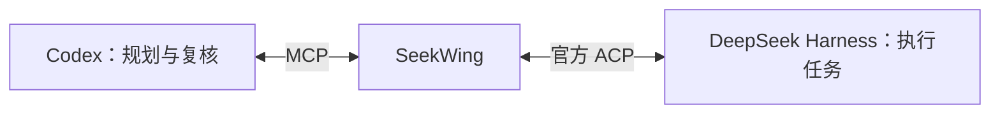

# SeekWing · 寻翼

**让 DeepSeek 成为 Codex 的工作子代理。**

[English](README.md) · [MIT 许可证](LICENSE)

SeekWing 是一个早期阶段的开源项目，计划通过 Codex 插件、MCP 服务和 DeepSeek Harness 官方 ACP，实现“Codex 分配任务，DeepSeek 执行，Codex 审查和验收”的协作流程。

**当前状态：设计阶段，尚未实现可安装的插件或 ACP 桥接服务。**

## 名字的含义

**Seek** 呼应 DeepSeek，**Wing** 代表羽翼与僚机。寻翼希望成为可靠的执行伙伴：承接具体工作，由 Codex 统筹任务并独立核对结果。

## 计划架构

- **Codex 插件**：统一安装集成和工作流 Skill。
- **MCP 服务**：提供创建任务、查询进度、读取结果、追加指令和取消任务的接口。
- **官方 ACP**：管理工作代理运行时和持久会话。
- **复核 Skill**：指导 Codex 检查产物、执行必要验证，并对不合格结果提出修正要求。

ACP 工作代理运行在独立的 Harness 进程中。第一版不包含对已运行桌面会话的直接控制。

## 第一阶段计划

- [ ] 实现 ACP 桥接和会话生命周期管理。
- [ ] 通过 MCP 提供 `start_task`、`get_task`、`wait_task`、`reply_task` 和 `cancel_task`。
- [ ] 持久保存任务状态、结果和执行证据。
- [ ] 编写任务委派与结果复核 Skill。
- [ ] 验证派发、执行、审查、返工和验收的完整流程。
- [ ] 打包首个可在本机安装的 Codex 插件版本。

## 参考资料

- [DeepSeek Harness](https://github.com/deepseek-ai/deepseek-harness)
- [Harness 官方 ACP](https://github.com/deepseek-ai/deepseek-harness/tree/master/packages/acp/acp)
- [OpenAI 插件文档](https://developers.openai.com/plugins)

SeekWing 是独立项目，与 DeepSeek AI 和 OpenAI 无隶属关系。

## 许可证

[MIT](LICENSE)。
