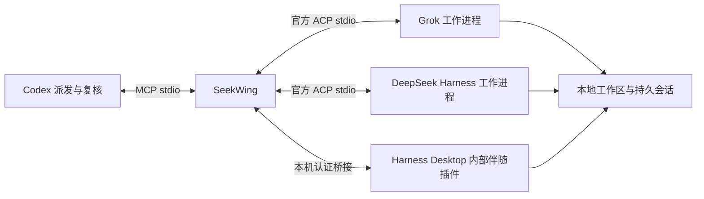

# SeekWing · 寻翼


**让 DeepSeek 和 Grok 成为 Codex 的子代理。Codex 派任务并复核，原生代理执行。**

[English](README.md) · [MIT](LICENSE)

Seek 来自 DeepSeek，Wing 代表搭档和僚机。插件采用 **MCP 服务 + 委派复核 Skill**，支持独立后台 ACP 和 Harness 桌面会话两种执行方式。终端命令用于启动 MCP、安装桌面伴随插件和诊断连接。

**v0.4.4 增加终端式实时执行流**：命令和工具输出在同一个控制台持续追加或更新，支持暂停/恢复跟随。活动卡片每 0.5 秒同步本地 ACP 事件，显示 CLI 实际发出的内容；尚不镜像完整原生 TUI，也不模拟逐字输出。

**v0.4.3 支持 Markdown 回复**：标题、列表、表格和代码块直接排版；执行方、权限、目录、会话编号等默认收进“任务详情”。自动刷新保留展开状态和正文阅读位置，渲染库随插件内置，不执行输出中的 HTML。

**v0.4.2 展开实时执行日志**：直接展示回复、命令、执行状态和结果文本；超过 100 次工具调用后继续保留近期结果。已用真实 Grok 运行中的分段输出验证。

**v0.4.1 修复任务卡片空白**：从工具输入提前绑定任务，兼容文本结果和宿主预加载数据，每秒刷新并跟随最新输出。更新后新开聊天并重新打开卡片。

**v0.4.0 引入任务来源追踪、能力查询和可选 MCP Apps 任务卡片。** [设计与显示边界](docs/task-visibility.zh-CN.md)。卡片需宿主支持；侧栏独立聊天通过用户明确要求后创建的 Codex 监督聊天实现，插件本身不创建聊天。

**v0.3.0 引入 Grok 适配器**：同一组 MCP 工具支持 `backend: deepseek | grok`，共享任务、续聊、取消和权限处理；旧 DeepSeek 历史与默认行为保持兼容。[Grok 实测与实现说明](docs/grok-adapter.zh-CN.md)。

v0.2.0 引入的桌面模式可在已运行的 Harness Host 中执行任务，并在工作区列表显示会话；独立后台 ACP 模式继续保留。macOS、Harness Desktop **0.2.1-rc.2**、Node **24.12.0** 上已验证真实生成、同会话续聊和编辑文件。Windows 和其他 Harness 版本尚未实测。



`background` 每轮使用独立的官方 ACP 进程；`desktop` 使用已运行的桌面 Host。两种模式都可以继续原会话，`reply_task` 固定保留原来的模式、工作区和权限。执行位置是当前电脑；P330/SSH 远程桥接尚未实现。

## 安装

需要 Node.js **22+**、支持插件的新版 Codex，以及所选后端的官方 CLI 和登录态。DeepSeek 使用 [Harness](https://github.com/deepseek-ai/deepseek-harness)，Grok 使用 [Grok Build](https://github.com/xai-org/grok-build)；不需要同时安装两者。

```sh
codex plugin marketplace add heyzeyu/seekwing
codex plugin add seekwing@seekwing-marketplace
```

仓库包含构建好的 MCP 服务和依赖许可证。安装不需要执行 `npm install` 或构建，也不依赖尚未发布的 npm 包。安装后，如果当前聊天没有出现工具，打开新的本地 Codex 聊天。

本地开发时，克隆仓库并进入目录，然后执行：

```sh
codex plugin marketplace add "$PWD"
codex plugin add seekwing@seekwing-marketplace
node ./dist/seekwing.mjs doctor
```

默认走官方 API。在**启动 Codex 的进程环境中**设置 `DEEPSEEK_API_KEY`。兼容层会将它和文档列出的 SeekWing、代理环境变量传给这个 MCP。已运行的 GUI 不一定继承后来在终端设置的变量。不要将密钥提交进配置文件或放进任务指令。

macOS 优先使用真正的 Desktop 内置 CLI，避免误用同名的 SSH 脚本：

```text
/Applications/DeepSeek Harness.app/Contents/Resources/runtime/cli/bin/dsh
```

其他安装从 `PATH` 查找 `dsh`，也可用 `SEEKWING_DSH_COMMAND` 指定可执行文件的绝对路径。启动后检查官方 Harness ACP 身份，不会自动通过 `npx` 下载并执行软件。

`doctor` 验证所选模式的握手，不代表密钥有效或模型生成成功。完整检查需要派发一个小任务并等待真实结果。桌面诊断分别报告 MCP 的 `version` 和运行中伴随插件的 `companionVersion`；版本不一致时提示更新和重启。

## 使用 Grok

先安装官方 Grok CLI 并完成 `grok login`，再执行：

```sh
node ./dist/seekwing.mjs doctor --backend grok
```

对 Codex 说“用 SeekWing 让 Grok 修这个问题，你审核并跑测试”，或给 `start_task`、`inspect_models`、`doctor` 设置 `"backend": "grok"`。模型必须取自同后端的 `inspect_models`；例如本机实测的 `grok-4.7-build-fast`，不要传 DeepSeek 的供应商/模型组合值。`SEEKWING_BACKEND=grok` 可改变新任务默认后端。

Grok 使用独立的 `grok agent --no-leader stdio` 进程，复用原生登录和 `~/.grok` 历史。完成后可在对应目录执行 `grok --resume <sessionId>` 继续原会话。不要同时从 TUI 和 SeekWing 操作同一个会话；目前不连接正在打开的 TUI，也不提供 Grok 的 `desktop` 模式。DeepSeek 的全局桌面偏好不会影响 Grok。

`reply_task` 保留后端、模式、工作区、模型和权限，即使新 MCP 的默认配置已经改变。旧版本未记录后端的任务仍按 DeepSeek 处理，不会迁移或重放。

Grok 在 macOS/Linux 使用原生 `read-only` / `workspace` 沙箱；SeekWing 的 `workspace-write` 对应后者。发送任务前读取该会话元数据，核对实际沙箱、工作区和会话 ID；不匹配则停止。显式关闭 yolo/auto 和自动更新，不启用一律批准。原生只读沙箱仍允许写入 Grok 运行数据和临时目录；workspace 沙箱额外允许写入指定工作区。两者可读取工作区以外的文件；macOS 不限制子进程网络，Linux 只读模式限制子进程网络。不要将“只读”理解为不能产生任何系统状态变化。Windows 暂不支持 Grok 适配器。

## 启用 DeepSeek 桌面会话

在安装后的 SeekWing 插件目录或本仓库目录运行：

```sh
node ./dist/seekwing.mjs desktop-install
node ./dist/seekwing.mjs desktop-doctor
```

安装命令把伴随插件放进稳定的 SeekWing 状态目录，再通过官方 `dsh plugin --profile desktop add` 登记；保留桌面配置和已有聊天。首次安装可能热加载。**更新伴随插件后需要重启 DeepSeek Harness**，再运行 `desktop-doctor`；这里重启的是 DeepSeek，不是 Codex。Codex 插件更新后，在新的本地 Codex 聊天中加载工具定义。

| 选择 | 运行方式 | 桌面可见 | 供应商与权限 |
| --- | --- | --- | --- |
| `background`（默认） | 独立官方 ACP 工作进程 | 不自动显示 | SeekWing 的独立 Home；原生审批转交 Codex |
| `desktop` | 当前 Harness Host 内的伴随插件 | 原生工作区列表和聊天 | 使用桌面登录/模型；需要审批或回答时在 Harness 中处理 |

给 `start_task` 设置 `"sessionMode": "desktop"`，或者对 Codex 说“让 DeepSeek 用桌面模式做这个任务，我要在 Harness 里看到会话”。工作区折叠时展开它即可看到 `SeekWing · <目录名>` 会话。`doctor`、`inspect_models` 也接受同一个参数。`SEEKWING_SESSION_MODE=desktop` 可改变新任务默认值。

桌面桥接仅监听随机的 `127.0.0.1` 端口，使用每次 Host 启动生成的随机令牌和私有端点文件，拒绝浏览器 Origin、错误 Host 和旧实例。端点文件是凭据，**不要复制进聊天或提交 Git**。连接失败时会明确失败，不会偷偷改用后台模型。后台历史不会被自动搬迁到桌面。

桌面模式通过官方模型选择接口设置会话模型；相同选择不会重复写入默认值；该接口也更新 Harness 的默认模型，行为与桌面选择模型一致。并发操作同一会话会被拒绝；运行中手工发送新消息会导致归属不确定，需先在 Harness 核对。取消只停止该轮任务，不退出 Harness，也不关闭会话。Host 重启或连接中断后不会自动重放指令。提交、选模型、取消和清理按该轮顺序处理；未开始提交的已取消任务不会补发。用户在原任务结束后继续手工聊天时，清理会保留新轮次。

卸载伴随插件可使用 Desktop 内置 `dsh plugin --profile desktop remove seekwing-desktop`，然后重启 Harness；Codex 的后台模式仍可使用。

## 使用方式

安装启用后，直接对 Codex 说：

> 用 SeekWing 让 DeepSeek 只读分析这个项目为什么测试失败，你核对它的结论。

> 让 DeepSeek 修复这个问题，允许修改当前工作区里相关的文件。你审核 diff，并独立重跑相关测试。

> 把这几条审核意见发回刚才的 DeepSeek 会话，让它修正后你再检查。

Skill 会明确工作区、允许范围和验收标准。分析默认只读；已授权的代码修改使用 `workspace-write`，无需重复确认。指定模型时，先对选定模式调用 `inspect_models`，传入其原始 `modelValue`，不静默切换模型。

## MCP 工具

| 工具 | 作用 |
| --- | --- |
| `list_backends` | 查询适配器能力、限制与调用聊天来源，不启动原生代理。 |
| `doctor` | 检查所选模式的 ACP 或桌面伴随插件握手，不调用模型。 |
| `inspect_models` | 读取所选模式的模型和推理选项；桌面模式不创建空会话。 |
| `start_task` | 创建任务并返回 ID；默认只读、600 秒截止时间。 |
| `get_task` | 读取分页输出、进度、权限请求和最近的工具证据。 |
| `wait_task` | 单次最多等 30 秒；等待超时不会取消任务。 |
| `reply_task` | 继续已结束任务的原会话，保留工作区和权限。 |
| `cancel_task` | 取消并等待工作进程停止；不回滚文件。 |
| `respond_to_permission` | 对原生权限请求作一次性选择，不自动批准。 |
| `list_tasks` | 按当前聊天/全部、后端、状态或任务链过滤，再取最近记录。 |

派发参数示例：

```json
{
  "title": "修复加法错误",
  "backend": "deepseek",
  "workspace": "/absolute/path/to/project",
  "instruction": "修复 sum.mjs 的加法错误，只修改这个文件。",
  "acceptance": "现有 node --test sum.test.mjs 通过，测试文件不变。",
  "permissionMode": "workspace-write",
  "sessionMode": "desktop",
  "timeoutSeconds": 600,
  "idempotencyKey": "sum-fix-1"
}
```

创建成功只代表收到任务。同一份指令重试时复用 `idempotencyKey`，不要在同一个 key 下更改参数。记录包含会话 ID、前一轮 ID、实际选择的 `modelValue` 和 `sessionMode`、输出、工具状态和结束原因。`configuredDefaultRoute` 是默认路由，实际选择以 `modelValue`、`configOptions` 为准。

用户取消刚好遇到原生已完成响应时，保留真实的 `completed/end_turn`，并记录取消请求；超过任务截止时间仍标记失败。

`completed` 表示原生代理轮次结束且 SeekWing 已完成清理；桌面会话仍保留，**仍需 Codex 核对验收标准**。输出上限停止标为 `incomplete`，模型或连接错误标为 `failed`。已完成的一轮也可能有失败的工具调用，需要复核。服务中断后不会自动重放指令，应先检查是否已经修改了文件。

## 权限与数据

DeepSeek 后台模式设置 `DSH_PERMISSION_MODE` 和最后一层原生配置；桌面模式使用会话级原生 sandbox/approval 事件。两种模式使用真正的 `read-only` / `workspace-write` 沙箱，不暴露 `danger-full-access`。只读任务不能通过 SeekWing 提权。后台写入任务的原生权限请求会转交 Codex，桌面请求保留在 Harness UI；只有该具体操作已有用户授权时，才能选择 `allow_once`。普通项目编辑授权不包含沙箱外权限。

任务文本不是逐文件强制白名单。需要隔离其他修改时，使用独立 checkout/worktree。`SEEKWING_ALLOWED_ROOTS` 检查提交时选择的工作区和真实路径，不是额外的读取权限沙箱。配置的原生程序、Home 和插件应当可信。

跨 MCP 进程的取消和权限选择通过完整文件原子发布；未写完的消息不会被任务所有者读取，写入失败时不会投递半条消息。并发重试仍复用原 `idempotencyKey`；竞争失败或结果不确定时不会生成替代任务记录，也不会自动重发原指令。

默认状态目录：

- macOS：`~/Library/Application Support/SeekWing`
- Linux：`$XDG_STATE_HOME/seekwing`，未设置则为 `~/.local/state/seekwing`
- Windows（未实测）：`%LOCALAPPDATA%/SeekWing`

后台模式默认 Harness Home 是状态目录中的 `harness/`，与 Desktop 分开；桌面模式使用当前 Host 的原生存储。记录包含任务指令和执行证据，使用原子写入和私有文件权限。桥接层过滤已知凭据环境变量的值、它们在任务记录及嵌套工具证据中的常见 JSON 转义形式，以及常见 token 格式，但不能保证识别源码中的所有秘密，不应派发不必要的敏感内容。桥接层不保存思考片段；Harness 自身保留原生会话历史。

桌面 HTTP 请求体上限为 512 KiB，先拼接字节再解码 UTF-8，支持 MCP 允许的长中文指令。ACP 和桌面伴随插件均在发送指令前检查协议兼容性。只有升级不兼容的伴随插件时才需要执行 `desktop-install` 并重启 Harness。v0.4.0 的任务归属和卡片改动只需新开 Codex 聊天，不要求重启原生代理；已有协议兼容的伴随插件可以继续使用。

截止时间可设为 10–3600 秒。后台取消先走 ACP，不响应时终止所拥有的进程组；桌面取消使用原生 session.cancel，不终止 Desktop Host。未确认该轮停止时保留中断或清理错误，清理结束后才标记终态。MCP 并发上限按进程计算，桌面 Host 额外限制同时持有的任务为 8 个；使用同一状态目录的服务共享会话锁。历史没有自动过期，删除前应确认相关任务已停止。

任务证据写入失败时，SeekWing 取消该轮并保留 `persistenceError`，不会继续执行或报告正常完成。短暂故障恢复后会落盘失败状态；持续写入失败时，当前 MCP 的查询保留内存中的失败结果，并拒绝新任务。应恢复存储后重启该 MCP；进程退出后，未落盘状态无法保留，旧记录按中断处理，不自动重放。

会话锁以完整文件原子发布；旧锁回收串行处理并重新核对所有者。如果进程恰好在回收锁期间退出，可能留下 `.recovery` 标记。此时会明确拒绝继续回收，先确认相关进程和原生任务已停止，再检查并移除错误信息中指出的标记。不要在任务运行时清空锁目录。

历史列表逐批读取记录，最多同时读取 8 项，并只保留需要返回的最近记录，避免随历史数量增加而同时打开所有文件和载入全部证据。列表仍需要扫描历史，尚未使用分页索引。

## 配置

| 环境变量 | 默认值 / 含义 |
| --- | --- |
| `CODEX_THREAD_ID` / `CODEX_SESSION_ID` | 调用聊天来源的环境变量后备值；请求元数据和明确传入的真实聊天编号优先。 |
| `SEEKWING_BACKEND` | 默认 `deepseek`，可设为 `grok`；单次任务可覆盖。 |
| `SEEKWING_GROK_COMMAND` | Grok 可执行文件绝对路径；优先 `~/.grok/bin/grok`，再查 `PATH`。 |
| `SEEKWING_GROK_ARGS` | 可信启动前缀参数 JSON 数组，默认 `[]`。 |
| `SEEKWING_GROK_HOME` | 原生 Grok Home：`GROK_HOME` 或 `~/.grok`；复用原生登录与历史。 |
| `SEEKWING_GROK_MODEL` | 可选默认模型；未设定时使用 Grok 原生选择，与 DeepSeek 路由无关。 |
| `XAI_API_KEY` | 可选；仅在 Grok 宣告支持该认证方式时使用，否则使用原生缓存登录。 |
| `SEEKWING_DSH_COMMAND` | 官方 CLI 绝对路径；macOS 优先内置 CLI，再查 `PATH`。 |
| `SEEKWING_DSH_ARGS` | 可信启动参数前缀的 JSON 数组，默认 `[]`；任务通过 ACP 传输，不拼接 shell 命令。 |
| `SEEKWING_STATE_DIR` | 上述平台状态目录。 |
| `SEEKWING_SESSION_MODE` | `background`；也可设置 `desktop`，单次任务可覆盖。 |
| `SEEKWING_DESKTOP_ENDPOINT` | `<状态目录>/desktop/endpoint.json`；可自定义目录和文件名，安装与客户端须使用相同值。 |
| `SEEKWING_DESKTOP_HOME` | 仅安装时使用：`DSH_HOME` 或 `~/.dsh`，选择桌面 profile。 |
| `SEEKWING_DSH_HOME` | `<状态目录>/harness`；可显式指定已有可信 Home。 |
| `SEEKWING_PROVIDER` | `deepseek-official`。 |
| `SEEKWING_MODEL` | `deepseek-flash`；必须是当前 Harness 和供应商支持的路由。 |
| `SEEKWING_ALLOWED_ROOTS` | 可选，平台路径分隔符分开的绝对根目录。 |
| `SEEKWING_MAX_CONCURRENT` | 每个 MCP 默认 `2`，范围 `1`–`8`。 |
| `DEEPSEEK_API_KEY` | 默认官方 API 的凭据。 |

桌面模式使用现有 Harness 登录态，已通过 `deepseek-account/deepseek-flash`、High 真实验证。仅共享后台 `DSH_HOME` 不能代替桌面桥接：ACP 不会向正在运行的桌面工作区登记会话或推送实时事件。

其他 MCP 客户端可启动 `node /absolute/path/to/seekwing/dist/seekwing.mjs mcp` 并配置环境变量传递。标准输出只传输 MCP 消息。仓库同时提供便携格式和 Codex 环境变量兼容层。

## 开发和验证

```sh
npm ci --ignore-scripts
npm run check
npm run build
npm test
npm pack --dry-run
```

84 项确定性测试使用独立的 DeepSeek/Grok ACP 模拟器和桌面 Host 适配器，覆盖双模式完成、桌面认证/会话隔离/取消/拒绝回退，以及生命周期、续聊、幂等、权限、会话锁、跨进程取消与权限拒绝、截止时间、输出截断、脱敏、工作区边界和崩溃恢复。Grok 回归额外覆盖非交互认证、精确模型选择、后端隔离、旧历史兼容、沙箱不匹配时拒绝发送任务和跨进程取消，不需要模型密钥。

可选实测**会调用真实 DeepSeek 或 Grok，消耗对应额度**，只修改自动生成的临时工作区，并独立重跑示例测试：

```sh
SEEKWING_NATIVE_TEST_ROOT=/absolute/path/to/scratch node test/native-smoke.mjs

# Grok：真实生成、重启后续聊、改文件、只读拒绝与取消
SEEKWING_NATIVE_TEST_ROOT=/absolute/path/to/scratch node test/native-grok-smoke.mjs

# 已安装桌面伴随插件且 Harness 正在运行：
SEEKWING_SESSION_MODE=desktop SEEKWING_NATIVE_TEST_ROOT=/absolute/path/to/scratch node test/native-smoke.mjs
```

仓库提交构建后的 `dist/seekwing.mjs`、`desktop/index.mjs` 和 `dist/THIRD_PARTY_NOTICES.txt`，确保干净安装可直接使用；CI 重建并检查一致性。依赖版本已锁定，ACP SDK **1.4.0** 与本次实测 Harness 一致。

## 参考与许可证

- [官方 Harness ACP](https://github.com/deepseek-ai/deepseek-harness/tree/master/packages/acp/acp)
- [官方 Grok ACP 文档](https://docs.x.ai/build/cli/headless-scripting)
- [官方 Grok 源码](https://github.com/xai-org/grok-build)
- [ACP 协议](https://agentclientprotocol.com/)
- [OpenAI 插件打包](https://developers.openai.com/plugins/build/plugins)

本项目独立维护，与 DeepSeek AI、xAI、OpenAI 无隶属关系。源码采用 [MIT](LICENSE)，依赖见[第三方许可证](dist/THIRD_PARTY_NOTICES.txt)。
